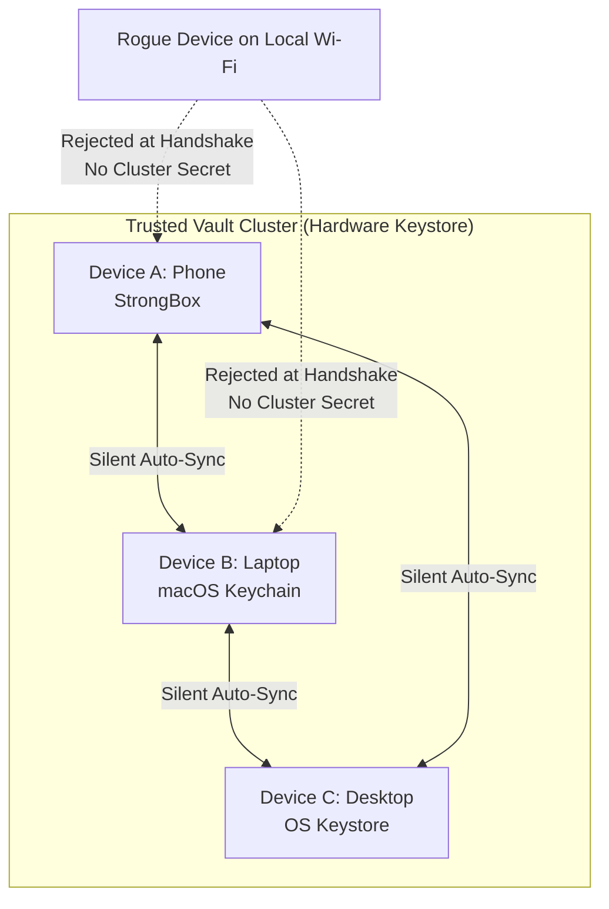
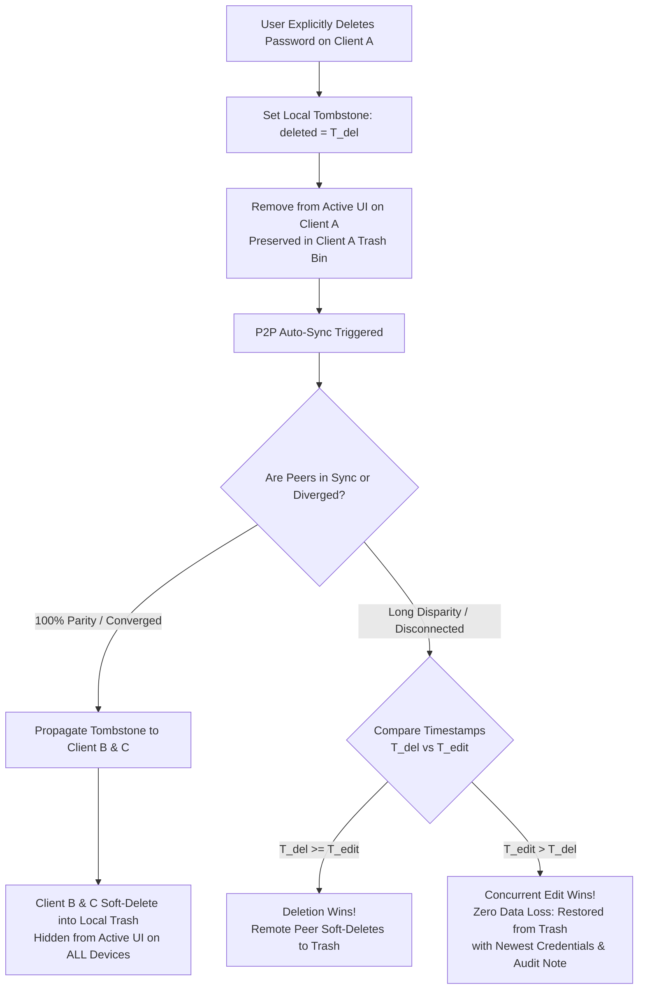
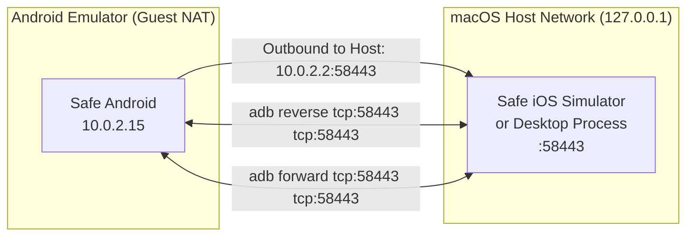

# Safe Synchronization & Reconciliation Architecture (SYNCHRONIZATION.md)

## 1. Executive Summary & The Prime Directive

The primary objective of Safe's Peer-to-Peer (P2P) synchronization engine is **zero data loss**.
Safe stores user passwords, notes, financial credentials, and recovery codes. Under no circumstances should an automated sync routine permanently discard user data due to clock skew, ambiguous state, or network interruptions.

### The Retentive Invariant
> **"Always make a retentive mistake, never a destructive mistake."**
> If conflict resolution cannot deterministically prove the user's intent to destroy or overwrite data, Safe **retains both versions** or **concatenates information**. An extra review item is a minor, transient inconvenience; a deleted password or truncated 2FA recovery code is an irreversible disaster.

---

## 2. Security Architecture: The Vault Cluster Secret & Hardware Keystore

To enable effortless background auto-sync without sacrificing security, Safe uses a **Vault Cluster Secret** stored strictly in hardware-backed secure storage.

```
Vault Cluster ID:       UUID (Identifies this specific user's vault cluster)
Vault Sync Secret:      256-bit cryptographic key (AES-256-GCM + HMAC-SHA256)
Hardware Storage:       • Android: Android Keystore / StrongBox
                        • iOS: iOS Keychain / Secure Enclave
                        • Desktop / macOS: macOS Keychain / OS Keystore
```

- **Zero User Exposure**: The user never sees, copies, or manages hex keys. The key lives entirely inside hardware-backed storage.
- **Lost Secret Recovery**: If a device is wiped or its keychain cleared, nothing is broken: the user simply runs the 8-digit PIN pairing ceremony once from any other active device to re-inject the cluster secret.

### 2.1. Trust Topology: Multi-Device Mesh
When a new device joins the cluster via PIN with **any single existing device**, it receives the Vault Cluster Secret.
- **Transitive Mutual Trust**: Device C pairs with Device A $\implies$ Device C can now also auto-sync with Device B directly on local Wi-Fi without needing a separate pairing ceremony.



---

## 3. Auto-Discovery & Zero-Drift Synchronization

To eliminate drift before conflicts can accumulate, Safe auto-syncs silently over local Wi-Fi:
1. **mDNS Announcement**: Safe announces `_safe-sync._tcp.` with its ephemeral port and `vaultClusterId`.
2. **Mutual Cryptographic Challenge**: Peers verify each other via HMAC-SHA256 challenge-response using the hardware-stored `Vault Sync Secret` in under 15ms. Unauthenticated connections are dropped immediately.
3. **Trigger Events**:
   - On app unlock.
   - 2 seconds after any local password addition, edit, or deletion.
   - Periodic heartbeat while app is active in foreground on Wi-Fi.

---

## 4. Git-Style Fast-Forward Merges & Hash Lineage

Safe guarantees mathematical convergence by maintaining a lightweight peer state table in SQLite:

```sql
CREATE TABLE sync_peer_state (
    peer_id TEXT PRIMARY KEY,       -- Remote device identifier
    last_shared_hash TEXT NOT NULL, -- SHA-256 vault checksum at last sync
    last_sync_timestamp INTEGER     -- Epoch millis
);
```

### 4.1. The Canonical Vault Checksum
Every device computes an immutable Merkle hash representing its entire database state:
```
entry_hash = SHA-256(cxfItemId + name + username + password + note + categoryName + modifiedAt + isDeleted)
vault_checksum = SHA-256(sorted entry_hashes)
```
- Parity between any two devices is mathematically verified if and only if:
  $$\text{vault\_checksum}_A == \text{vault\_checksum}_B$$

### 4.2. Three-Peer Fast-Forward Sequence ($A \leftrightarrow B$, $A \leftrightarrow C$, then $C \to B$)

```mermaid
sequenceDiagram
    autonumber
    participant A as Device A (Phone)
    participant B as Device B (Tablet)
    participant C as Device C (Laptop)

    rect rgb(235, 245, 255)
    Note over A,B: 1. SYNC A ↔ B
    Note over A,B: A and B sync and reach state Hash_AB.<br/>Both save: last_shared_hash = Hash_AB.<br/>★ Result: A == B == Hash_AB
    end

    rect rgb(235, 255, 235)
    Note over A,C: 2. SYNC A ↔ C
    Note over A,C: A (holding Hash_AB) syncs with C.<br/>They merge and produce superset Hash_ABC.<br/>Both save: last_shared_hash = Hash_ABC.<br/>★ Result: A == C == Hash_ABC (holds superset of A, B, and C)
    end

    rect rgb(255, 245, 235)
    Note over A,B: 3. SYNC B UP TO SPEED (Either A → B or C → B)
    C->>B: "Device B, what is your current hash?"
    B-->>C: "My hash is still Hash_AB."
    Note over C,B: FAST-FORWARD MERGE!<br/>C verifies: "B's current hash matches our common ancestor Hash_AB.<br/>B has NOT modified anything since last sync!"<br/>• B does ZERO conflict checks.<br/>• B directly FAST-FORWARD IMPORTS Hash_ABC in 50ms!
    end

    Note over A,B,C: FINAL STATE: A == B == C == Hash_ABC<br/>Zero user prompts on Device B. Parity mathematically proven.
```

---

## 5. Conflict Resolution & Deferred Reconciliation (CAS Model)

When independent conflicting edits occur on both sides:

### 5.1. Immediate Resolution (Single Handshake)
- While the connection socket is open, Device A presents conflict cards to the user (e.g. 1-2 divergent items).
- User picks the resolution on Device A.
- Device A immediately pushes the unified state to Device B across the open socket.
- Device B applies the state. Both show `Sync Complete ✓` ($A == B$).

### 5.2. Deferred Resolution ("I'll Do It Later")
If the user chooses not to resolve conflicts immediately:
1. The socket closes cleanly. Neither database is corrupted or partially written.
2. Device A saves a **Sync Snapshot Marker**:
   ```json
   {
     "targetPeer": "Device_B",
     "targetBaseHash": "Hash_B_at_disconnect",
     "snapshotTime": 1789356600000
   }
   ```
3. User resolves conflicts at their leisure on Device A.
4. On next sync with B:
   - If `currentHash(B) == targetBaseHash`: **Fast-Forward Merge**. B is updated with A's reconciled state automatically. **Zero prompts on B.**
   - If `currentHash(B) != targetBaseHash`: B had independent edits in the interim. Safe prompts only for the new deltas since the snapshot.

---

## 6. Password Deletion Architecture: Dual-Track Protocol & The Ghost Password Paradox

### 6.1. The Ghost Password Paradox
The foundational directive of Safe is **Zero Data Loss**. However, if deletion handling is naive, "Zero Data Loss" degenerates into an unacceptable failure mode: **"The user is forbidden from ever deleting a password."**

Prior to this architecture, when a user clicked Delete on Client A:
1. Client A immediately hard-deleted the SQLite record.
2. Two seconds later, P2P auto-sync exchanged payloads with Client B (which still held the active entry).
3. Client A observed that Client B possessed an entry that Client A did not have locally.
4. Client A misdiagnosed this item as `NEW_ENTRY_ADDED`, re-inserted it, and **resurrected the deleted password immediately**.
5. Even when soft-deletion tombstones existed, the conflict resolver had `selectedIsDeleted = false` hardcoded to prioritize data retention, unconditionally reviving deleted passwords.

This behavior is completely unacceptable. Deletion is an explicit, deliberate user action. Safe resolves this paradox through a **Dual-Track Deletion Protocol**.



---

### 6.2. Track 1: Full 100% Sync Parity (Converged Cluster)
When all devices are connected and synchronized:
1. **Explicit Deletion Action**: When the user deletes a password on Client A (Desktop, iOS, or Android), Client A does **not** silently hard-delete the item. Instead, Client A marks the record with a **Tombstone** (`deleted = T_del`).
2. **Immediate UI Disappearance**: The item is immediately removed from Client A's active category and password list. It is visible only if the user navigates into the Trash bin.
3. **P2P Tombstone Broadcast**: Client A sends `SyncItem(isDeleted = true, modifiedAt = T_del)` to all connected cluster peers.
4. **Peer Soft-Deletion to Local Trash**:
   - Peers B and C receive the tombstone.
   - Because $T_{\text{del}} \ge T_{\text{edit}}$, Peers B and C accept the deletion.
   - **Crucial Invariant**: Peers B and C do **not** resurrect the item on Client A. Instead, Peers B and C **soft-delete the item into their own local Trash bins** (`deleted = T_del`).
5. **Cluster-Wide Convergence**:
   - The password vanishes from the active screen across **Android, iOS, and Desktop** simultaneously within 2 seconds.
   - **Safety Net Guarantee**: If the deletion was accidental, the credential is not permanently lost—it safely resides in the Trash bin of every peer and can be restored from any device within the retention grace period (`softDeleteDays`, default 30 days).

---

### 6.3. Track 2: Long Sync Disparity / Concurrent Edit Conflicts
When two devices have been disconnected for an extended period (e.g. Device B offline for weeks while traveling):
1. **Case 2A: Deletion Without Remote Modification ($T_{\text{del}} \ge T_{\text{edit}}$)**:
   - Device A deleted the credential at $T_{\text{del}}$.
   - Device B was offline and did not touch or edit the credential ($T_{\text{edit}} < T_{\text{del}}$).
   - Upon reconnecting, the conflict resolver observes $T_{\text{del}} > T_{\text{edit}}$.
   - **Outcome**: The deletion represents the latest intent. Device B soft-deletes the item into its own Trash bin. Zero user interruption.
2. **Case 2B: Concurrent Edit After Deletion ($T_{\text{edit}} > T_{\text{del}}$)**:
   - Device A deleted the credential at $T_{\text{del}}$.
   - Concurrently while offline, the user on Device B updated the password or recovery note at $T_{\text{edit}} > T_{\text{del}}$.
   - Upon reconnecting, the conflict resolver observes that Device B has credentials newer than Device A's deletion.
   - **Outcome (The Retentive Invariant)**: In accordance with Zero Data Loss, **the newer edit wins**. The item is restored from Trash on Device A, updated with Device B's newest credentials, and annotated with a conflict recovery note:
     ```text
     [Sync Conflict: Restored from Trash because credentials were updated on Device B at 2026-10-12 18:30 after deletion]
     ```

---

### 6.4. Permanent Deletion & Purge Lifecycle (Empty Trash)
Tombstones cannot be retained indefinitely without unbounded database growth. Safe implements a deterministic 30-day tombstone lifecycle:

```
[Active Password] ──(User Deletes)──> [Trash Bin / Soft-Deleted] ──(30 Days or Empty Trash)──> [Permanent Purge]
                                      • isDeleted = true                         • Hard deleted from SQLite
                                      • Propagates across P2P                    • Tombstone Immunity active
```

1. **Retention Window (`softDeleteDays`)**:
   - By default, soft-deleted items remain in SQLite with `deleted = timestamp` for 30 days (`Preferences.getSoftDeleteDays()`).
   - Routine auto-sync shares tombstones across all paired devices within this 30-day window.
2. **Permanent Purge Guards**:
   - When 30 days expire (or the user explicitly clicks "Empty Trash"):
     - The record is hard-deleted from SQLite via `db.hardDeleteSiteEntry(id)`.
   - **Tombstone Immunity**:
     - If a peer sends an incoming sync item with `isDeleted == true` and that item does not exist locally (it was already purged locally), Safe **never** treats it as a new active password. It remains purged.
   - **Peer Sync Lineage Horizon**:
     - Safe tracks `last_sync_timestamp` for every paired peer in `sync_peer_state`.
     - If an offline peer reconnects and presents an active item whose `modifiedAt < last_sync_timestamp`, the local peer recognizes that this item was already present during the previous sync and has since been purged by the cluster. The item is soft-deleted on the returning peer rather than resurrected into the cluster.

---

### 6.5. Execution & Implementation Plan

| Step | Component | Action | Verification |
| :--- | :--- | :--- | :--- |
| **1. UI Soft Deletion** | `desktop/Main.kt`<br>`MainViewController.kt` | Replace raw `db.hardDeleteSiteEntry` calls on delete actions with `db.markSiteEntryDeleted(id, timestamp)` and invoke auto-sync. | Deleting item removes it from active list and notifies peers. |
| **2. Timestamp Normalization** | `SyncConflictResolver.kt` | In `readLocalDatabaseAsSyncItems()`, normalize both `deleted` and `passwordChangedDate` to epoch milliseconds. | Ensures $T_{\text{del}}$ and $T_{\text{edit}}$ are compared with identical time units. |
| **3. Tombstone Conflict Logic** | `SyncConflictResolver.kt` | In `analyzeConflicts()`, evaluate $T_{\text{del}} \ge T_{\text{edit}}$ for `DELETED_ON_ONE_SIDE`. For `NEW_ENTRY_ADDED`, set `selectedIsDeleted = item.isDeleted`. | Deletion propagates when newer; concurrent edits restore credential when newer. |
| **4. Database Application** | `SyncConflictResolver.kt` | In `applyResolvedConflictsToLocalDatabase()`, when `selectedIsDeleted == true`, update local entry with `deleted = delTimeInSeconds` (soft-delete to Trash). | Remote deletion moves item to local Trash bin without resurrection. |
| **5. Automated Unit Tests** | `ThreeDeviceConvergenceUnitTest.kt` | Add test cases verifying: (a) 100% convergence deletion propagation across 3 devices, (b) concurrent edit vs deletion conflict resolution. | All tests pass with zero regressions. |

---

## 7. Core Data Rules & Invariants

1. **Entity Identity**: Primary match via `cxfItemId` (UUID in extensions); fallback via `cleanDomain(url/name) + username` across all categories.
2. **Deletions vs. Additions**:
   - Explicit tombstone ($T_{\text{del}} > T_{\text{edit}}$): Soft-delete applied across peers.
   - Missing item with NO tombstone (emptied trash or CSV import): Retained as addition (Zero Data Loss).
3. **Renames & Moves**:
   - Last-Write-Wins on `passwordChangedDate` / `modifiedAt`.
   - Entry stays in the winning category immediately.
   - Competing category names/lineage are preserved in `extensions["syncConflict"]` for review.
4. **Note Merging**: Conflicting notes are non-destructively concatenated:
   ```text
   === Note (Device A) [2026-10-11 12:00] ===
   {note A}
   === Note from Device B [2026-10-11 12:30] ===
   {note B}
   ```

---

## 8. Concrete 3-Peer Test Database Matrix (Android, iOS, Desktop)

### 8.1. Initial Peer States

| Category | Device A (Android) | Device B (iOS) | Device C (Desktop) | Test Condition |
| :--- | :--- | :--- | :--- | :--- |
| **Work** | • `Company Intranet`<br>• `Slack` *(Added)*<br>• `Jira` *(Active, T=1000)* | • `Company Intranet`<br>• `Asana` *(Added)*<br>• **`Jira` (DELETED, T=2500)** | • `Company Intranet`<br>• `Notion` *(Added)*<br>• `Jira` *(Active, T=1000)* | **Deletion on iOS** (`Jira`)<br>**Additions on all 3** (`Slack`, `Asana`, `Notion`) |
| **Finance** | • `Revolut Card`<br>• **`Bank of America` (DELETED, T=2500)**<br>• `PayPal` (v1 pass, T=1000) | • `Revolut Card`<br>• `Bank of America` *(Active, T=1000)*<br>• `PayPal` (**v2 new pass**, T=3000) | • `Revolut Card`<br>• `Bank of America` *(Active, T=1000)*<br>• `PayPal` (v1 pass, T=1000) | **Deletion on Android** (`Bank of America`)<br>**Password Update on iOS** (`PayPal`)<br>**Shared Base** (`Revolut Card`) |
| **Personal** | • `Netflix Streaming` *(Renamed T=1500)*<br>• `Spotify` *(Added)*<br>• `Steam Gaming` *(Active, T=1000)* | • **`Netflix (Personal)`** *(**Renamed T=3000**)*<br>• `Apple Music` *(Added)*<br>• `Steam Gaming` *(Active, T=1000)* | • `Netflix` *(Original T=500)*<br>• **`Steam Gaming` (DELETED, T=2500)** | **Deletion on Desktop** (`Steam Gaming`)<br>**3-Way Rename Conflict** (`Netflix`)<br>**Additions** (`Spotify`, `Apple Music`) |
| **Social** | • **`GitHub` (MOVED TO `Work`, T=2000)**<br>• `Twitter` *(Original T=500)*<br>• `Reddit` *(Active, T=1000)* | • `GitHub` *(Remains in `Personal`, T=500)*<br>• **`X.com`** *(**Renamed T=2500**)*<br>• `Reddit` *(Active, T=1000)* | • `GitHub` *(MOVED TO `Social`, T=1200)*<br>• `Twitter Blue` *(Renamed T=1200)*<br>• **`Reddit` (DELETED, T=2500)** | **Cross-Category Move Conflict** (`GitHub`)<br>**3-Way Rename Conflict** (`Twitter` vs `X.com`)<br>**Deletion on Desktop** (`Reddit`) |

---

### 8.2. Reconciled Target State (Identical Across Android, iOS, Desktop)

#### Active Passwords in UI (Total: 10 Active Items):
1. **Work (5 items)**:
   - `Company Intranet` (Shared base)
   - `Slack` (Added by Android)
   - `Asana` (Added by iOS)
   - `Notion` (Added by Desktop)
   - **`GitHub`** (Android move to `Work` @ $T=2000$ won over Desktop @ $T=1200$)
2. **Finance (2 items)**:
   - `Revolut Card` (Shared base)
   - `PayPal` (Updated with winning password `v2_new` from iOS @ $T=3000$)
3. **Personal (3 items)**:
   - `Netflix (Personal)` (Winning rename from iOS @ $T=3000$)
   - `Spotify` (Added by Android)
   - `Apple Music` (Added by iOS)
4. **Social (1 item)**:
   - `X.com` (Winning rename from iOS @ $T=2500$)

#### Purged by Tombstone (4 Items Hidden in Trash, 0 Active):
- ❌ `Jira` (Deleted by iOS @ $T=2500$)
- ❌ `Bank of America` (Deleted by Android @ $T=2500$)
- ❌ `Steam Gaming` (Deleted by Desktop @ $T=2500$)
- ❌ `Reddit` (Deleted by Desktop @ $T=2500$)

---

## 9. Emulator, Simulator & Local Testing Rig Setup

To test P2P synchronization without physical Wi-Fi or across headless CI rigs, Safe supports emulator-to-host and simulator-to-desktop bridging.

### 9.1. Real Devices vs. Emulator/Simulator Detection

Safe distinguishes between **physical hardware on Wi-Fi** and **virtualized emulators/simulators**:

| Environment | Host Resolution & Candidate Routing | Runtime Detection Mechanism |
| :--- | :--- | :--- |
| **Physical Android Device** | Connects strictly via resolved IPv4 LAN addresses (`192.168.x.x`). Never falls back to `10.0.2.2` or localhost. | `SyncNetworkService.isEmulator()` returns `false` (inspects `Build.FINGERPRINT`, `Build.HARDWARE`, `Build.MODEL`, `Build.PRODUCT`). |
| **Android Emulator (QEMU)** | Injects `10.0.2.2` host gateway when Wi-Fi peers are absent. Allows `adb reverse` / `adb forward` loopbacks. | `SyncNetworkService.isEmulator()` returns `true` (`isAndroidGuest = true`). |
| **Physical iOS Device** | Resolves raw IPv4 addresses from `NSNetService.addresses` (`sockaddr_in`). | Extracted IPv4 is a non-loopback LAN IP. |
| **iOS Simulator** | Shares the macOS host network stack; uses `127.0.0.1` or host LAN IP. | `LocalDeviceSyncService.ios.kt` extracts `sender.hostName` / `127.0.0.1`. |

> **Critical Rule**: On real physical devices, `10.0.2.2` and `127.0.0.1` candidate fallbacks are **disabled**. Injecting host loopbacks on real devices would cause silent connection black holes or self-connections. They are enabled **only** when `isAndroidGuest` is `true` or running inside the simulator.

---

### 9.2. Network Topology & Port Forwarding Matrix

- **Default Sync Port**: `SAFE_SYNC_DEFAULT_PORT = 58443` (Desktop fallback: `58444`).
- **Android Emulator**: Isolated inside QEMU NAT (`10.0.2.15`). The host machine is reachable at `10.0.2.2`.
- **iOS Simulator / Desktop**: Runs natively on the macOS host network interface (`127.0.0.1`).



---

### 9.3. ADB Port Forwarding Commands for Testing

#### A. Android Emulator (Client) $\to$ macOS Host / iOS Simulator (Server)
When the iOS Simulator or Desktop app displays the 8-digit PIN and listens on `:58443`:
1. Android connects directly to `10.0.2.2:58443` (handled automatically by `ContinuousAutoSyncCoordinator` when `isAndroidGuest == true`).
2. Or configure ADB reverse proxy:
   ```bash
   adb reverse tcp:58443 tcp:58443
   ```
   Now Android connecting to `127.0.0.1:58443` reaches the macOS host server.

#### B. macOS Host / iOS Simulator (Client) $\to$ Android Emulator (Server)
When the Android Emulator displays the 8-digit PIN and listens on `:58443`:
1. Set up forward port mapping from host to emulator:
   ```bash
   adb forward tcp:58443 tcp:58443
   ```
2. The host / iOS Simulator connects to `127.0.0.1:58443`, which ADB routes into the emulator.

#### C. Preventing Host Port Collision (`BindException`)
If `adb forward` is active and you later try to run a server socket on macOS host:
```bash
# Clear specific forward
adb forward --remove tcp:58443

# Or clear all port forwards to avoid "Address already in use"
adb forward --remove-all
adb reverse --remove-all
```

---

### 9.4. Step-by-Step Test Procedure for Multi-Device Rig

1. **Deploy Seed Databases**:
   - Master Password: `12345678`.
   - Android: `adb push <seed.db> /data/data/fi.iki.ede.safe.debug/databases/safe`
   - iOS: `cp <seed.db> "$(xcrun simctl get_app_container booted fi.iki.ede.safe.debug data)/Documents/safe.db"`
   - Desktop: `cp <seed.db> ./safe.db`

2. **Unlock Both Devices**:
   - Ensure both apps are unlocked past the Master Password screen into the Category list.

3. **Initiate Pairing Ceremony**:
   - Device 1 (Server): Tap `Device Sync` $\to$ `Display PIN` (generates random 8-digit code, e.g., `8487 - 9314`, and starts listening on port `58443`).
   - Device 2 (Client): Tap `Device Sync` $\to$ Enter the 8 digits $\to$ Tap `Connect & Sync`.

4. **Verify Reconciliation**:
   - Both devices converge to identical Merkle root hashes (`vault_checksum`).
   - Deleted tombstones are hidden; new entries and edits appear on both devices.

